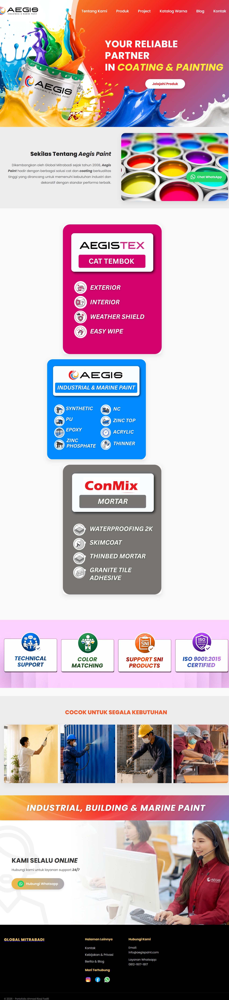

<div align="center">

# AEGIS PAINT

**Your reliable partner in coating & painting.**

Website profil dan katalog solusi cat untuk kebutuhan industri, bangunan, dan kelautan.

[](https://aegis-paint.vercel.app/)


</div>

<p align="center">
  
</p>

## Tentang proyek

Website ini dibuat untuk memperkenalkan Aegis Paint, lini cat dan coating dari Global Mitrabadi. Halaman menampilkan profil singkat, kategori produk, beragam kebutuhan aplikasi, serta akses cepat untuk menghubungi tim.

## Yang tersedia

- Navigasi yang menyesuaikan layar desktop dan mobile.
- Informasi perusahaan dan kategori produk.
- Sorotan solusi untuk kebutuhan rumah, industri, bangunan, dan kelautan.
- Tombol WhatsApp untuk menghubungi tim.
- Layout responsif untuk desktop, tablet, dan ponsel.

## Teknologi

- HTML5
- CSS3
- JavaScript

## Menjalankan secara lokal

Proyek ini berupa website statis dan tidak memerlukan proses build.

1. Clone repository ini.
2. Buka `index.html` di browser, atau jalankan folder melalui XAMPP.

## Struktur proyek

```text
.
├── images/
│   └── website-preview.png
├── index.html
├── script.js
├── style.css
└── README.md
```

## Demo

[Kunjungi website Aegis Paint](https://aegis-paint.vercel.app/)
